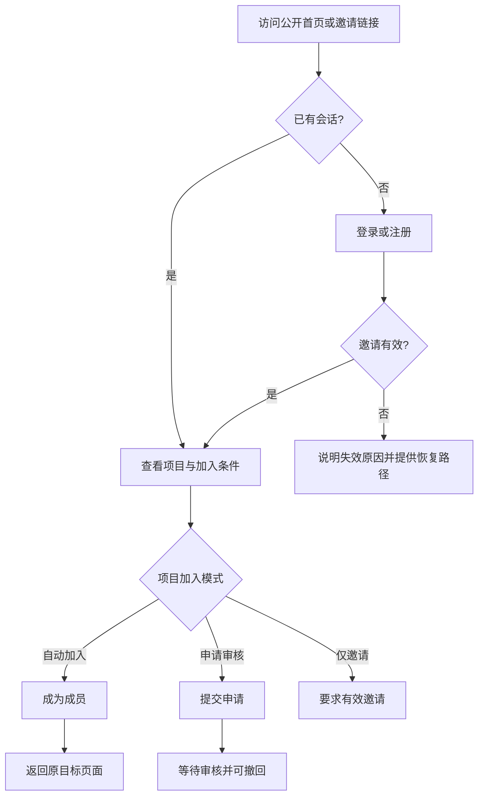
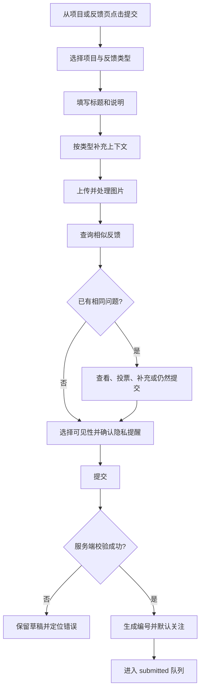
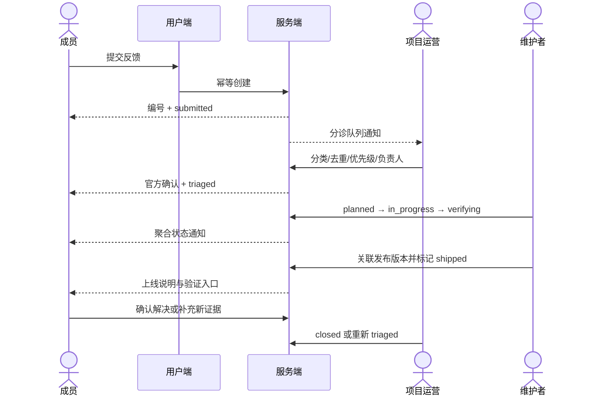
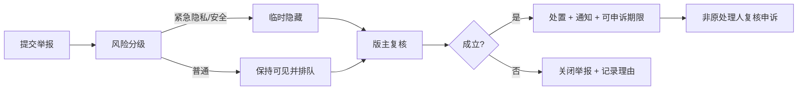

# 02 · 信息架构与核心流程

> 状态：草案  
> 最后核对：2026-10-23  
> 权威范围：页面结构、路由、用户旅程、页面状态和交互边界

## 1. 导航原则

- 用户端一级导航不超过 5 项：`首页 / 项目 / 反馈 / 议题 / 我的`；桌面端放顶部，移动端使用底部导航并保留文字标签。
- “提交反馈”是页面内主要动作，不占用独立一级导航；在首页、项目页和反馈列表均保持可见。
- 项目上下文优先：从项目页进入提交时预选项目，返回后恢复原筛选和滚动位置。
- 关键页面都有稳定 URL，可深链、分享和在通知中打开。
- 后台与用户端导航层级分离，后台不通过隐藏按钮代替服务端权限。

## 2. 用户端信息架构

```text
/
├─ /projects
│  └─ /projects/:project_slug
│     ├─ /updates
│     ├─ /feedback
│     ├─ /topics
│     ├─ /leaderboard（贡献榜，登录可见）
│     └─ /members（成员可见）
├─ /updates/:post_id
├─ /feedback
│  ├─ /new
│  └─ /:project_slug/:number   ← 原计划 /:feedback_key，见下方说明
├─ /topics
│  └─ /:topic_id
├─ /notifications
├─ /profile/:handle
├─ /settings
│  ├─ /profile
│  ├─ /notifications
│  ├─ /security
│  └─ /privacy
├─ /login
├─ /register（必须携带或填写有效邀请码）
（没有 /recover：账号找回已删除，见 `adr/0011`）
└─ /invite/:token
```

路由按 Next.js App Router 落地：`app/(site)/...` 为上述页面。运营后台不在这个工程里——
它复用现有的 `admin/`（`adr/0008`），所以没有 `app/(admin)/`。
私密资源无权访问时统一返回不泄露存在性的页面，不在前端先请求后闪现内容。

**反馈详情的地址用 `/feedback/:project_slug/:number` 而不是 `/feedback/:feedback_key`**：
展示编号（如 `FBE-1024`）里的前缀是项目的 `key_prefix`，它和 `slug` 不是同一个字段，
从 key 推不出该查哪个项目。后端读接口是 `/api/v1/feedback/issues/:slug/:number`，
前台路由与它一一对应，就不需要为了 URL 好看再加一个按 key 查询的后端接口。
页面上显示给用户的仍然是 `FBE-1024`。

## 3. 页面清单

| 页面 | 核心目标 | 主要内容 | 访问 |
| --- | --- | --- | --- |
| 首页 | 30 秒内理解社区并找到当前重点 | 简短价值说明、置顶动态、活跃项目、近期高质量反馈、本周议题、加入 CTA | 公开 |
| 项目目录 | 找到可参与的项目 | 搜索、状态/标签筛选、项目卡片、空状态 | 公开/登录增强 |
| 项目主页 | 理解项目、加入并开始反馈 | 项目说明、测试状态、入口、置顶动态、反馈摘要、议题 | 按项目可见性 |
| 动态详情 | 阅读测试任务或上线小结 | 正文、关联版本/反馈、评论、分享 | 按动态可见性 |
| 反馈广场 | 搜索已有问题并参与 | 搜索、项目/类型/状态筛选、排序、列表、提交入口 | 公开内容可匿名看 |
| 提交反馈 | 提交结构化、可处理的反馈 | 类型、项目、标题、描述、动态字段、附件、可见性、相似项 | 登录 + 项目资格 |
| 反馈详情 | 跟踪并协作解决 | 状态、正文、证据、时间线、官方回复、评论、投票、关注 | 按反馈可见性 |
| 议题列表/详情 | 回答项目当前问题 | 说明、截止时间、选项/回答、结果规则 | 登录回答 |
| 通知 | 处理与自己相关的变化 | 分组列表、未读、批量已读、设置入口 | 登录 |
| 个人主页 | 展示可公开贡献 | 资料、加入项目、被采纳反馈、等级（可隐藏） | 按隐私设置 |
| 设置 | 管理身份、通知与数据 | 资料、会话、偏好、导出、注销 | 登录 |
| 登录/注册/邀请 | 安全进入并回到原任务 | 用户名密码表单、邀请码、「无法找回密码」静态告知、错误恢复 | 公开 |

注册表单字段顺序：**用户名 → 密码 → 昵称 → 邀请码**。邀请码放最后是因为它通常是
复制粘贴来的，而且带邀请链接进来时已预填；前三项才需要用户现想。

「找回密码」这一行原本在这里，已随 `adr/0011` 整条删除 —— 没有这个流程，也没有这个页面。
| 贡献榜 | 看到项目内贡献分布 | 排名、采纳数、隐藏自己的入口 | 登录可见 |

## 4. 运营后台信息架构

```text
/admin
├─ /overview
├─ /projects
│  └─ /:project_id/{overview,members,settings}
├─ /feedback
│  ├─ /inbox
│  └─ /:feedback_id
├─ /content/{updates,topics,tags,releases}
├─ /moderation/{reports,hidden,appeals}
├─ /community/{users,invitations,contributions}
├─ /notifications/templates
├─ /analytics
└─ /system/{roles,audit,settings}
```

项目运营登录后默认进入自己上次使用的项目；跨项目角色才显示项目切换器。切换项目时清除不兼容筛选，保留时间范围等通用筛选。

## 5. 核心流程

### 5.1 访客加入项目



异常路径：邀请过期、已使用、项目暂停、账号受限、成员名额已满。错误信息不能透露其他账号是否存在。

### 5.2 提交反馈



交互规则：

- 长表单自动保存本机草稿；私密正文不得持久化到第三方分析工具；
- 上传失败可单张重试，不丢失已填写内容；
- 相似项只是建议，不能强制阻止提交；
- 提交按钮异步期间禁用并显示进度，使用幂等键处理重试；
- 成功后进入反馈详情并告知下一步，不只显示短暂 Toast。

### 5.3 反馈分诊与状态闭环



每一步的公开说明与内部备注分开存储；通知失败不回滚状态事务，而由异步任务重试。

### 5.4 合并重复反馈

1. 运营从候选相似项中选择主反馈；
2. 系统显示将迁移的关注者、标签和关联，要求二次确认；
3. 原反馈进入 `duplicate`，写明主反馈编号；
4. 原 URL 保留，只展示摘要和跳转，不重复展示私密内容；
5. 关注者去重后关注主反馈并收到一次通知；
6. 解除合并时恢复原状态与关系，所有动作进入审计。

不同可见性的反馈不能直接合并：私密项只能关联为内部重复，不能把正文或作者暴露给公开主反馈。

### 5.5 举报与申诉



## 6. 页面通用状态

每个数据页面都必须设计以下状态：

| 状态 | 要求 |
| --- | --- |
| 首次加载 | 保留布局尺寸的骨架，避免内容跳动；超过 10 秒给重试 |
| 空数据 | 说明为什么为空，并给符合权限的下一步动作 |
| 搜索无结果 | 保留筛选，提供清空/调整建议，不显示通用空状态 |
| 加载失败 | 显示可理解原因、请求编号和重试；不清空现有数据 |
| 无权限 | 说明需要登录、加入项目或联系管理员；私密资源不确认其存在 |
| 已删除/已合并 | 显示状态、原因和可用去向 |
| 离线 | 保留已加载内容；写操作保存草稿，不伪装成功 |
| 会话过期 | 保存非敏感草稿，登录后回到原路径继续 |
| 速率受限 | 显示可重试时间，不自动快速重放请求 |

## 7. 搜索、筛选与排序

- 列表筛选写入 URL，刷新、分享和返回都能恢复；
- 默认排序：反馈广场“最近更新”，项目内收件箱“待分诊优先”；
- 支持 `q / project / type / status / tag / author / assignee / updated_after`；
- 排序提供“最近更新、最新提交、最多投票”；后台增加“最久未响应、优先级”；
- 搜索结果高亮必须安全转义；私密资源在搜索索引层就做权限过滤；
- 游标分页用于持续列表，后台需要跳页的稳定报表可用页码分页；
- 返回列表时恢复滚动位置、筛选、排序和已展开项目。

## 8. 响应式布局

| 宽度 | 用户端 | 后台 |
| --- | --- | --- |
| 320–639 | 单列、底部一级导航、筛选抽屉、提交按钮不遮内容 | 仅支持必要应急操作；复杂表格改卡片或横向显式滚动 |
| 640–1023 | 单列主内容 + 可折叠辅助区 | 可折叠侧栏，筛选两列 |
| ≥1024 | 顶部导航；详情可用主栏 + 辅助栏 | 固定侧栏 + 主工作区；队列可双栏 |

核心功能必须在 375px、200% 缩放和键盘模式下可用。移动端触控目标至少 44×44 CSS px，固定导航必须预留安全空间。

## 9. 无障碍与键盘路径

- 页面进入时焦点移动到主内容标题；提供“跳到主要内容”；
- 标题层级连续，卡片不使用可点击 `div`；
- 图标按钮有可访问名称，装饰图标从无障碍树隐藏；
- 状态、优先级和角色同时使用文字/图标，不只用颜色；
- 表单错误与字段关联，提交失败聚焦错误摘要或首个错误；
- 弹窗锁定焦点，关闭后返回触发点，`Esc` 可关闭非强制弹窗；
- 拖拽排序必须有键盘和上移/下移替代；
- 动效尊重 `prefers-reduced-motion`，实时状态变化使用适当 `aria-live`。

## 10. 埋点事件（最小集）

| 事件 | 目的 | 禁止字段 |
| --- | --- | --- |
| `project_viewed` | 项目访问与加入转化 | 私密项目名、完整 URL 查询 |
| `feedback_form_started` | 表单漏斗 | 正文、附件名 |
| `similar_feedback_shown` | 去重提示效果 | 搜索原文全文 |
| `feedback_submitted` | 完成率 | 标题、正文、IP |
| `feedback_followed` | 关注使用情况 | 用户公开标识 |
| `topic_answered` | 议题参与 | 自由回答正文 |
| `triage_completed` | 运营效率 | 内部备注 |
| `feedback_shipped` | 闭环效率 | 私密反馈内容 |

埋点使用随机会话/用户标识并遵守隐私设置；业务事实（状态、贡献）直接由数据库事件计算，不依赖前端埋点。

## 11. SEO 与分享

- 只索引公开首页、公开项目、公开动态和公开反馈；登录、后台、搜索结果、成员/私密内容 `noindex`；
- canonical 只指向当前公开 URL，不把带筛选参数的列表当独立页面；
- 分享卡只包含公开标题、项目名、状态和安全摘要；
- 私密链接的 HTML 首屏和元数据都不能泄露内容；
- 项目归档或反馈合并使用稳定页面说明，不直接 404。

## 12. 验收

- 路由覆盖所有 P0 页面，且公开、成员、私密边界明确；
- 提交、分诊、合并、举报四条流程包含主路径和异常路径；
- 每个页面有加载、空、错误、无权、离线/会话过期策略；
- 移动、键盘、屏幕阅读器和深链行为均有明确约束。