# 03 · 领域模型与数据设计

> 状态：草案  
> 最后核对：2026-10-23  
> 权威范围：逻辑实体、关系、约束、状态、索引、数据分级与留存  
> 注意：实现后表结构以数据库迁移为机器权威源，本文件同步解释业务语义。

## 1. 建模原则

1. 所有业务数据显式带项目作用域，跨项目访问不能依赖调用方“记得过滤”。
2. 反馈正文、状态历史、公开评论、内部备注分开存储，防止序列化时误泄露。
3. 状态、贡献、审核与高敏管理动作采用只追加事件/历史表，不覆盖关键证据。
4. 软删除只用于需要恢复或保留引用的业务内容；会话、临时上传等按生命周期物理清理。
5. 对外使用不暴露数据规模的 ID；反馈另有项目内连续展示编号。
6. 时间统一存 UTC，API 使用 ISO 8601；展示按用户时区转换。
7. 用户输入默认不可信，存原始纯文本/受限 Markdown 与经过清洗的呈现结果，不存可执行 HTML。

`[假设]` 主业务实体使用 UUIDv7；是否使用数据库原生生成取决于最终数据库与框架。每个可编辑聚合带 `version` 做乐观并发控制。

## 2. 领域关系图

```mermaid
erDiagram
    USER ||--|| USER_PROFILE : has
    USER ||--o{ SESSION : owns
    USER ||--o{ INVITATION : creates
    USER ||--o{ PROJECT_MEMBER : joins
    PROJECT ||--o{ PROJECT_MEMBER : contains
    PROJECT ||--o{ PROJECT_INVITATION : accepts
    PROJECT ||--o{ POST : publishes
    PROJECT ||--o{ RELEASE : ships
    PROJECT ||--o{ FEEDBACK : receives
    PROJECT ||--o{ TOPIC : asks
    PROJECT ||--o{ PROJECT_TAG : defines

    FEEDBACK ||--o{ FEEDBACK_REVISION : keeps
    FEEDBACK ||--o{ FEEDBACK_STATUS_HISTORY : transitions
    FEEDBACK ||--o{ FEEDBACK_TAG : labels
    PROJECT_TAG ||--o{ FEEDBACK_TAG : applied
    FEEDBACK ||--o{ COMMENT : discusses
    FEEDBACK ||--o{ FEEDBACK_VOTE : receives
    FEEDBACK ||--o{ SUBSCRIPTION : followed
    FEEDBACK ||--o{ ATTACHMENT : includes
    FEEDBACK o|--o{ FEEDBACK : duplicate_of
    RELEASE ||--o{ RELEASE_FEEDBACK : includes
    FEEDBACK ||--o{ RELEASE_FEEDBACK : shipped_in

    POST ||--o{ COMMENT : discusses
    POST ||--o{ ATTACHMENT : includes
    TOPIC ||--o{ TOPIC_OPTION : offers
    TOPIC ||--o{ TOPIC_RESPONSE : receives
    USER ||--o{ TOPIC_RESPONSE : answers

    USER ||--o{ NOTIFICATION : receives
    USER ||--o{ CONTRIBUTION_EVENT : earns
    FEEDBACK o|--o{ CONTRIBUTION_EVENT : causes
    USER ||--o{ MODERATION_REPORT : reports
    MODERATION_REPORT ||--o{ MODERATION_ACTION : resolved_by
    USER ||--o{ AUDIT_LOG : operates
```

图中没有强画出所有多态目标。实现时不采用无约束的 `target_type + target_id` 作为核心外键；评论、附件、举报若需要多目标，应使用带 CHECK 与约束触发器的明确关联，或按目标拆关联表。

## 3. 身份与项目

### 3.1 `users`

| 字段 | 类型建议 | 约束/说明 |
| --- | --- | --- |
| `id` | UUIDv7 | 主键 |
| `handle` | varchar(32) | 不区分大小写唯一；3–32 字符 `[a-z0-9_-]`，不允许纯数字与保留词；公开标识，改名频率受限 |
| `handle_normalized` | varchar(32) | 唯一索引用的小写规范化值 |
| `password_hash` | text | Argon2id，含可升级参数；非空（本项目只有密码登录） |
| `password_updated_at` | timestamptz | 改密时间，用于安全提示 |
| ~~`recovery_code_hash`~~ | text | **已废弃**（`adr/0011`）：恢复码功能已删除，此列恒为空串、不再读写。`recovery_code_set_at` / `recovery_code_used_at` 从未落地 |
| `status` | enum | `active / restricted / suspended / deleted` |
| `session_version` | integer | 封禁、改密、重置或安全退出时递增，令旧会话失效 |
| `created_at/updated_at` | timestamptz | UTC |
| `deleted_at` | timestamptz, nullable | 注销完成时间 |

**不收集邮箱和手机号**（`adr/0007`）。因此没有邮箱字段、没有邮件通道，也没有 OAuth/外部身份标识。账号凭据与公开资料分离；`password_hash` 不得出现在任何 DTO、日志或审计差异中。

**也没有任何找回凭据**（`adr/0011`）：不存恢复码，唯一的改密入口要求提供当前密码。
领域模型 `User` 上没有与找回相关的字段。

### 3.2 `user_profiles`

`user_id`（PK/FK）、`display_name`、`bio`、`avatar_attachment_id`、`timezone`、`locale`、`show_contribution_level`、`show_attribution`、`updated_at`、`version`。

- `display_name` 1–40 字符；`bio` ≤ 300 字符；
- 公开资料审核与账号状态分离；
- 头像使用处理后附件，不允许外链图片直出。

### 3.3 `sessions`

`id`、`user_id`、`token_hash`、`created_at`、`last_seen_at`、`expires_at`、`revoked_at`、`ip_prefix_hash`、`user_agent_family`、`session_version`。

只存会话令牌哈希。IP 只保留满足安全检测所需的短期、截断或不可逆摘要，不记录完整 IP 到普通业务日志。

### 3.4 `projects`

| 字段 | 说明 |
| --- | --- |
| `id`、`slug`、`name`、`summary`、`description` | `slug` 全局唯一、稳定；展示名可改 |
| `status` | `draft / recruiting / active / paused / archived` |
| `visibility` | `public / members`；项目本身不使用 `private`，草稿已覆盖该需求 |
| `join_mode` | `open / application / invite_only / closed` |
| `logo_attachment_id`、`cover_attachment_id` | 处理后的项目素材 |
| `feedback_key_prefix` | 2–8 位大写字母/数字，全局唯一，如 `APP` |
| `next_feedback_number` | 项目内编号计数器，事务内分配 |
| `owner_user_id` | 项目所有者；同时应有成员记录 |
| `created_at/updated_at/archived_at/version` | 生命周期和并发控制 |

### 3.5 `project_members`

`project_id`、`user_id`、`role`（`member / operator / maintainer / owner`）、`status`（`pending / active / removed`）、`joined_at`、`invited_by`、`version`；主键 `(project_id, user_id)`。

同一项目至少保留一个有效 `owner`。最后一个所有者不能退出、被移除或降级，除非先转移所有权。

### 3.6 邀请

- `invitations`：平台级邀请，可限制总次数、到期时间和允许项目；
- `project_invitations`：项目邀请，保存 `token_hash`、`project_id`、`role`、`max_uses`、`used_count`、`expires_at`、`revoked_at`、`created_by`；
- `invitation_redemptions`：一条兑换事件，唯一 `(invitation_id, user_id)`。

只在创建时返回一次明文邀请 token，数据库仅存哈希。核销计数与成员创建在同一事务完成。

## 4. 内容与版本

### 4.1 `posts`

字段：`id`、`project_id`、`type`（`announcement / test_task / changelog / discussion`）、`title`、`body_source`、`body_rendered`、`visibility`、`status`（`draft / published / hidden / archived`）、`author_user_id`、`published_at`、`edited_at`、`pinned_until`、`release_id`、`comment_count`、`version`、时间戳。

约束：

- `published` 必须有 `published_at`；
- `changelog` 建议关联 `release_id`；
- 置顶只对已发布内容有效；项目内有效置顶数由领域事务控制 ≤ 3；
- `body_rendered` 由受信清洗器生成，不能接收客户端提交的 HTML。

### 4.2 `post_revisions`

`id`、`post_id`、`editor_user_id`、`title`、`body_source`、`change_summary`、`created_at`。发布后的每次修改先写修订，再更新当前快照。

### 4.3 `releases`

`id`、`project_id`、`version_label`、`title`、`summary`、`released_at`、`status`（`draft / published / withdrawn`）、`created_by`、`version`。项目内 `version_label` 唯一。

`release_feedback`：`release_id`、`feedback_id`、`note`、`created_at`，唯一 `(release_id, feedback_id)`。只有所属项目相同才能关联。

## 5. 反馈聚合

### 5.1 `feedback`

| 字段 | 类型建议 | 约束/说明 |
| --- | --- | --- |
| `id` | UUIDv7 | 主键 |
| `project_id` | UUID | 必填，所有关联必须同项目 |
| `number` | bigint | 项目内连续展示编号，唯一 `(project_id, number)` |
| `key` | 生成/缓存字段 | `${project.feedback_key_prefix}-${number}`，可由查询构造 |
| `author_user_id` | UUID, nullable | 注销后可匿名化；内部仍保留审计映射策略 |
| `type` | enum | `bug / experience / feature / content / access / other` |
| `title` | varchar(160) | 规范化后 5–160 字符 |
| `body_source` | text | 纯文本或受限 Markdown，建议 ≤ 20,000 字符 |
| `visibility` | enum | `public / members / private` |
| `status` | enum | 见 `01` 状态机 |
| `severity` | enum, nullable | `critical / major / minor / cosmetic`，主要用于 Bug |
| `priority` | enum | `critical / high / medium / low / unset` |
| `assignee_user_id` | UUID, nullable | 必须是该项目有效运营/维护者 |
| `duplicate_of_id` | UUID, nullable | 只在 `duplicate` 时必填；同项目、不可指向自身/形成环 |
| `latest_release_id` | UUID, nullable | `shipped` 时至少此字段或上线说明存在 |
| `vote_count/comment_count/follower_count` | integer | 事务维护的缓存计数，≥ 0，可由明细重建 |
| `last_activity_at` | timestamptz | 排序与超时提醒 |
| `triaged_at/shipped_at/closed_at` | timestamptz, nullable | 对应状态首次/当前进入时间 |
| `version` | integer | 乐观锁，从 1 开始 |
| `created_at/updated_at/deleted_at` | timestamptz | 软删除只供合规/恢复流程 |

跨字段约束：

- `status = duplicate` 时 `duplicate_of_id IS NOT NULL`，其他状态为空；
- `status = shipped` 时 `latest_release_id` 或非空上线说明至少一个存在；
- `assignee_user_id` 与 `latest_release_id` 必须属于同一项目；
- `private` 反馈的标题、正文、附件、评论不进入公开搜索和公开通知；
- 从 `submitted` 之后正文不覆盖，更新通过补充或修订表保留历史。

### 5.2 类型上下文

为避免一张表塞满稀疏字段，公共字段放 `feedback`，类型上下文放一对一表或 JSONB。首选结构化列；若用 JSONB，必须有版本化 schema 并在服务端校验。

建议公共上下文 `feedback_contexts`：

- `feedback_id`（PK/FK）
- `page_url_path`：只存站内路径或脱敏 URL，不存查询中的令牌；
- `app_version`、`browser_family`、`os_family`、`device_class`；
- `network_type`、`region_coarse`、`occurred_at`；
- `steps_to_reproduce`、`expected_result`、`actual_result`；
- `schema_version`。

严禁把 Cookie、Authorization、完整 IP、设备硬件唯一标识、密码或密钥放入上下文。

### 5.3 修订与补充

- `feedback_revisions`：保存进入分诊前的正文修改快照；
- `feedback_supplements`：进入分诊后由作者追加证据，字段含 `body_source`、`created_at`、`edited_until`；
- 补充可有附件，但不能修改原始复现步骤。

### 5.4 状态历史

`feedback_status_history`：`id`、`feedback_id`、`from_status`、`to_status`、`actor_user_id`、`public_note`、`internal_reason`、`release_id`、`created_at`。

- 只追加，不更新/删除；
- `internal_reason` 只进入后台 DTO；
- 状态更新与历史写入同一事务；
- 第一条为 `NULL → submitted`；
- 无效迁移在领域层拒绝，数据库可再用触发器或受限写权限保护。

### 5.5 标签与关联

- `project_tags`：`id`、`project_id`、`name`、`slug`、`color_token`、`description`、`archived_at`；项目内名称与 slug 唯一；
- `feedback_tags`：`feedback_id`、`tag_id`、`added_by`、`created_at`；要求同项目；
- `feedback_collaborators`：`feedback_id`、`user_id`、`created_at`，用户须是项目团队成员。

## 6. 互动

### 6.1 `comments`

字段：`id`、`project_id`、`feedback_id` 或 `post_id`、`parent_comment_id`、`author_user_id`、`kind`（`public / official / internal`）、`body_source`、`body_rendered`、`status`（`visible / hidden / author_removed / moderator_removed`）、`edited_at`、`created_at`、`version`。

约束：

- `feedback_id` 与 `post_id` 恰好一个非空；
- 只允许一层回复，父评论不能再有父级且目标必须一致；
- `internal` 仅允许反馈目标，且不进入普通评论计数和通知；
- `official` 只允许项目运营/维护者；
- 评论状态变化保留审核记录，不能硬删有互动/举报的评论。

### 6.2 `feedback_votes`

`feedback_id`、`user_id`、`created_at`，主键 `(feedback_id, user_id)`。用户必须是可读取该反馈的有效成员。投票计数是缓存，不是授权依据。

### 6.3 `subscriptions`

`id`、`user_id`、`project_id`、`feedback_id`（可空）、`event_mask`、`created_at`、`muted_until`；反馈关注唯一 `(user_id, feedback_id)`。项目级订阅与反馈级订阅语义分开。

## 7. 议题

### 7.1 `topics`

`id`、`project_id`、`title`、`description`、`type`、`visibility`、`result_visibility`（`before_vote / after_vote / after_close`）、`status`（`draft / scheduled / open / closed / archived`）、`starts_at`、`ends_at`、`created_by`、`response_count`、`version`、时间戳。

### 7.2 `topic_options`

`id`、`topic_id`、`label`、`position`；同议题位置唯一。议题开放后只允许修正文案，不允许增删选项导致历史结果失真。

### 7.3 `topic_responses`

`id`、`topic_id`、`user_id`、`text_answer`、`created_at`、`updated_at`、`version`，唯一 `(topic_id, user_id)`。选项关联用 `topic_response_options(response_id, option_id)`。

自由回答和选项选择必须与题型匹配；截止后不可修改。是否匿名展示与作者身份存储分开。

## 8. 附件

`attachments`：

- `id`、`owner_user_id`、`project_id`、`purpose`；
- `storage_key_original`（隔离/短期）、`storage_key_public`（处理后）；
- `original_filename_safe`、`detected_mime`、`size_bytes`、`width`、`height`、`sha256`；
- `scan_status`（`pending / clean / rejected / failed`）、`processing_status`；
- `visibility`、`created_at`、`expires_at`、`deleted_at`。

关联表：`feedback_attachments`、`supplement_attachments`、`comment_attachments`、`post_attachments`。附件只有在扫描和重编码成功后才能公开引用。未关联临时上传 24 小时后清理。

## 9. 通知、贡献与治理

### 9.1 `notifications`

`id`、`recipient_user_id`、`type`、`project_id`、`actor_user_id`、`resource_kind`、`resource_id`、`payload_safe`、`dedupe_key`、`read_at`、`created_at`。

`payload_safe` 只存最小、已脱敏呈现数据。`dedupe_key` 在时间窗口内唯一，用于聚合重复通知。

**只有站内通知**：账号不收集邮箱，没有邮件通道。因此首期不建 `notification_deliveries` 表，也没有供应商投递状态。若未来加入 Web Push（P2），再单独建投递表，且渠道失败不得写回业务事务。

### 9.2 `contribution_events`

`id`、`user_id`、`project_id`、`feedback_id`、`event_type`、`points_delta`、`reason`、`source_event_id`、`created_by`、`created_at`。

- 只追加，冲销写负数；
- 对自动事件使用唯一 `source_event_id` 防重复；
- 用户总分可缓存，但必须能从事件重算；
- 手工调整要求高权限、非空原因和审计。

### 9.3 举报与审核

- `moderation_reports`：举报人、目标、原因、说明、风险级别、状态、项目、创建时间；同一用户对同目标的开放举报唯一；
- `moderation_actions`：举报、动作、规则编号、公开原因、内部证据摘要、操作者、到期时间、创建时间；只追加；
- `appeals`：申诉人、原动作、说明、状态、复核人、决定与时间；复核人不能是原动作唯一操作者。

### 9.4 `audit_logs`

字段：`id`、`request_id`、`actor_user_id`、`actor_role`、`project_id`、`action`、`resource_type`、`resource_id`、`before_safe`、`after_safe`、`reason`、`ip_prefix_hash`、`created_at`。

审计差异必须在写入前脱敏，不记录密码、令牌、邀请明文、私密正文、附件内容或完整请求头。

## 10. 关键索引与查询

| 查询 | 建议索引 |
| --- | --- |
| 项目反馈按状态/最近活动 | `(project_id, status, last_activity_at DESC, id DESC)` |
| 全站公开反馈流 | `(visibility, status, last_activity_at DESC, id DESC)`，并使用部分索引排除删除项 |
| 作者的反馈 | `(author_user_id, created_at DESC, id DESC)` |
| 待分诊队列 | `(project_id, priority, created_at, id)` WHERE `status = submitted` |
| 负责人工作台 | `(assignee_user_id, status, priority, updated_at)` |
| 反馈编号解析 | unique `(project_id, number)`；项目前缀 unique |
| 评论列表 | `(feedback_id, created_at, id)` / `(post_id, created_at, id)` |
| 未读通知 | `(recipient_user_id, read_at, created_at DESC)` |
| 议题状态 | `(project_id, status, starts_at, ends_at)` |
| 邀请核销 | unique `token_hash`；`expires_at` 清理索引 |
| 贡献重算 | `(user_id, created_at, id)` 与唯一 `source_event_id` |

文本搜索首期使用数据库全文检索或适合目标语言的索引。私密/成员内容必须在查询本身加入授权条件，不能先查全量后在应用内过滤。

持续列表使用稳定游标 `(sort_value, id)`；排序字段必须走白名单。`vote_count` 相同时以 `id` 作为稳定次序。

## 11. 一致性与并发

- 创建反馈：分配项目编号、写反馈、首条状态历史、默认关注、outbox 事件在同一事务；
- 投票：明细唯一约束 + 原子更新计数；重复请求返回当前状态，不报内部冲突；
- 状态迁移：检查 `version` 和合法迁移，写历史、更新快照、贡献事件与 outbox；
- 合并重复：锁定主/从反馈，验证同项目与可见性，防止环，迁移关注关系并写审计；
- 邀请核销：锁邀请行，检查状态/次数/期限，创建成员与核销记录后递增计数；
- 发布版本：发布与关联反馈的 `shipped` 可分批，但每条反馈状态更新必须幂等并可恢复；
- 缓存计数允许最终一致，但授权、状态与可见性不能依赖缓存。

## 12. 数据分级与留存

| 级别 | 示例 | 处理 |
| --- | --- | --- |
| 公开 | 公开项目、动态、反馈、公开资料 | 可索引；删除/隐藏后及时清缓存 |
| 成员 | 封闭项目内容、成员列表 | 仅项目成员；不进入公开搜索/分享卡 |
| 私密 | 私密反馈、原始附件、邮箱、会话元数据 | 最小权限、加密、禁止普通日志记录 |
| 高敏 | 密码哈希、邀请 token 哈希、MFA、审计安全证据 | 单独访问策略；高敏操作重新认证 |

`[提议]` 留存：

- 未关联临时附件 24 小时；
- 已撤销会话安全元数据 90 天；
- 普通访问日志 30 天，安全日志 180 天；
- 审计日志至少 1 年，具体按部署地区法规确认；
- 用户注销请求 30 天冷静期后匿名化，法律/安全必须保留的数据做最小化隔离；
- 已发布公共内容按作者选择显示“已注销用户”，不保留公开署名；
- 私密反馈处理完成后允许作者申请删除附件或整条内容，保留不含正文的审计证明。

## 13. 迁移与种子数据

- 每个迁移包含向前与可行的回滚；不可逆数据迁移须分“扩展 → 回填 → 切换 → 清理”；
- 外键、唯一约束、CHECK 和索引随表迁移创建，不把核心不变量只留在代码；
- 种子只包含系统角色、权限、状态/类型定义和本地虚构项目，不含真实用户或参考站内容；
- 新增非空字段先允许空/给稳定默认，完成回填与兼容发布后再收紧；
- 删除字段前至少经过一个兼容发布周期，确认所有客户端和后台已停止使用。

## 14. 已定与待确认

已定（2026-10-23）：

- 数据库为 PostgreSQL 18，主键用标准库生成的 UUIDv7（`adr/0006`）；
- 登录身份为用户名，无邮箱/手机，**没有任何找回途径**（`adr/0011` 取代 `adr/0007` 的恢复码方案）；
- 不允许匿名/免注册反馈：注册需邀请码，互动需登录；
- 评论支持一层回复；
- 投票、议题、贡献值进入首发（M3 交付）；
- 项目不能自定义类型与状态，不预留自定义工作流表；
- 成员列表对项目成员可见，贡献榜对登录用户可见（`00` 第 8.2 节）。

待确认：

- 附件大小、数量与保留期是否沿用默认（≤ 10 MiB、6 张/条、未绑定 24 小时清理）；
- 部署地区与适用法规，决定审计与日志留存期；
- 反馈优先级是否对提交者公开。

## 15. 数据设计验收

- 每条反馈、评论、附件、通知都有明确项目与可见性边界；
- 状态机、合并、投票、邀请、贡献具备数据库约束和事务策略；
- 私密正文、内部备注、审计信息不会共用用户端 DTO；
- 关键列表都有稳定排序、游标和匹配索引；
- 删除、匿名化、留存和重算路径均已说明。