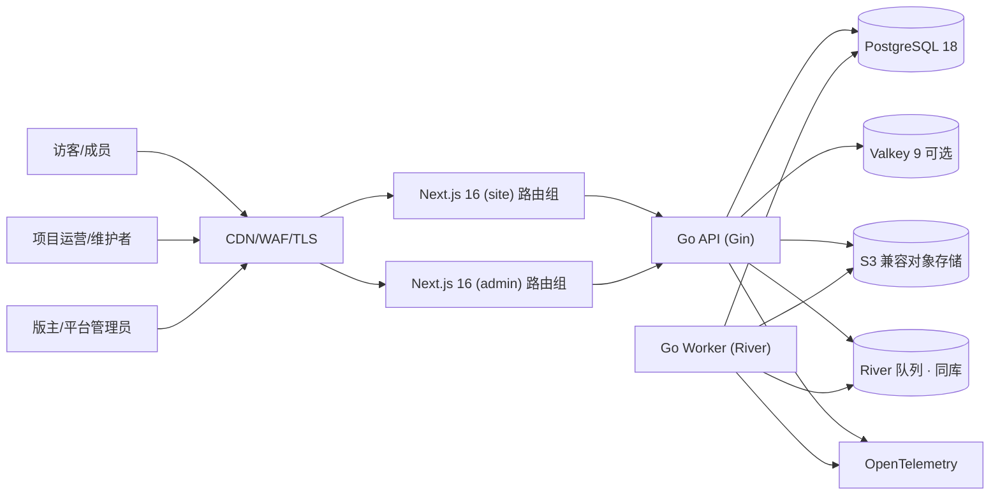

# 04 · 总体架构与技术选型

> 状态：已采纳（`adr/0002`、`adr/0006`）  
> 最后核对：2026-10-23  
> 版本基线核对日期：2026-10-23。实际版本以 `go.mod`、`go.sum`、`bun.lock` 为准。  
> 权威范围：系统边界、组件职责、数据流、技术选型与扩展触发条件

## 1. 架构目标

- 优先快速交付完整反馈闭环，而不是提前拆分微服务；
- 公开页面可被搜索引擎读取，私密内容在服务端完成权限裁剪；
- 用户端与运营后台共享业务契约，但权限、布局和入口清晰隔离；
- 核心写操作强一致，搜索、通知、计数和分析允许可恢复的最终一致；
- 本地、测试、预发、生产行为尽量一致，密钥和用户数据严格隔离；
- 能在不重写领域模型的前提下从单实例扩展到多实例。

## 2. 系统上下文



没有邮件/短信/第三方 IM 出站，也没有外部 Issue 同步：账号不收集邮箱，集成已明确排除（`00` 第 4.2 节）。

## 3. 应用形态

用户端与运营后台是**同一个 Next.js 工程的两个路由组**，后端是**一个 Go 模块化单体**，API 与 Worker 分进程但共享领域代码。

```text
feedback/
├─ api/
│  └─ openapi.yaml                 # 三方共用的机器契约（X0-3）
├─ service/                        # Go 1.27.3
│  ├─ cmd/api/                     # HTTP 进程
│  ├─ cmd/worker/                  # River 消费进程
│  ├─ cmd/admintool/               # 首个平台管理员、邀请码等离线操作
│  ├─ internal/
│  │  ├─ domain/                   # 状态机、不变量、策略（无框架依赖）
│  │  ├─ app/                      # 用例、事务、授权、幂等
│  │  ├─ adapters/                 # pgx/sqlc、对象存储、Valkey、River
│  │  ├─ http/                     # Gin 路由、中间件、DTO
│  │  └─ platform/                 # 配置、日志、遥测、ID、时钟
│  ├─ db/
│  │  ├─ migrations/               # goose SQL
│  │  └─ queries/                  # sqlc 源 SQL
│  └─ api/                         # 生成的服务端类型（如需要）
├─ web/                            # Next.js 16.4 + Bun 1.4
│  ├─ app/
│  │  ├─ (site)/                   # 公开与成员页面
│  │  ├─ (admin)/                  # 运营后台
│  │  └─ api/                      # Route Handler：仅会话与转发所需
│  ├─ src/features/
│  ├─ src/components/
│  ├─ src/lib/api/generated/       # 由 openapi.yaml 生成
│  ├─ src/lib/server/              # 仅服务端：会话、API 客户端、令牌
│  ├─ src/styles/tokens.css        # 三层设计 token
│  └─ messages/zh-CN.json          # 文案（首发单语言）
├─ deploy/local/                   # 独立 compose 与开发镜像
└─ docs/
```

目标结构，当前尚未创建，由 `X0-1` 落地。

## 4. 组件职责

| 组件 | 负责 | 不负责 |
| --- | --- | --- |
| Next.js `(site)` | 公开/成员页面 SSR、表单与交互、可访问性、SEO | 权限最终判断、直连数据库、持有业务密钥 |
| Next.js `(admin)` | 分诊与治理界面、批量操作、看板 | 绕过 API 改数据；前端隐藏不等于授权 |
| Next.js 服务端（Route Handler / Server Action） | 会话 Cookie、服务令牌转发、按需聚合、缓存头 | 业务规则、事务、状态机 |
| Go API | 身份、授权、业务规则、事务、契约、审计、读模型 | 大文件处理、慢通知、模板执行 |
| Go Worker | 附件扫描与派生、通知投递、搜索索引、超时提醒、清理 | 独立决定授权或业务最终状态 |
| PostgreSQL | 业务事实、约束、状态历史、River 队列 | 直接对客户端开放 |
| Valkey（可选） | 热点读、限流配额、短期锁 | 业务事实或唯一授权来源 |
| 对象存储 | 隔离原图与安全派生图 | 公开桶、处理用户内容 |
| OpenTelemetry | 日志、指标、链路 | 收集反馈正文、凭据等敏感内容 |

## 5. 技术选型

### 5.1 前端与运营后台

| 类别 | 选型 | 版本基线 | 选择理由 |
| --- | --- | --- | --- |
| 框架 | Next.js（App Router） | 16.4.x | 用户明确指定；SSR 与 Server Actions 覆盖公开页面与表单 |
| UI | React | 19.3.x | 与 16.4 配套 |
| 编译优化 | React Compiler | 1.0 | 自动记忆化，减少手写 memo |
| 运行时/包管理 | Bun | 1.4.x（当前 1.4.3） | 用户明确指定；安装、脚本与测试统一 |
| 语言 | TypeScript | 7.0.x | 严格模式；lint 工具链若仍需 TS 6 编程 API 则并存 |
| 样式 | Tailwind CSS | 4.3.x | 原生 CSS 配置、容器查询，与三层 token 配合 |
| 组件 | shadcn/ui（CLI v4）+ `radix-ui` | — | 组件进仓库，可按 `06` 规范改造；无障碍基础由 Radix 提供 |
| 表单 | react-hook-form + zod | — | 字段级错误与服务端校验形状一致 |
| 客户端数据 | Server Components / Server Actions 优先，必要处 TanStack Query v5 | — | 不默认引入全局状态库 |
| 图标 | Lucide | — | 统一线性 SVG |
| 图表 | Recharts 3（shadcn charts） | — | 仅后台看板，按路由懒加载 |
| 测试 | Bun 测试或 Vitest + Playwright | — | 单元 + E2E |

**生产运行时待实测**：Next.js 官方生产运行时是 Node.js。Bun 用于安装、脚本和测试已确定；是否用 Bun 跑生产 `standalone` 产物由 `X0-1` 实测决定，不通过则生产用 Node.js、工具链仍用 Bun。结论要回写 `12`。

### 5.2 后端

| 类别 | 选型 | 版本基线 | 选择理由 |
| --- | --- | --- | --- |
| 语言 | Go | 1.27.3 | 用户明确指定；当前安全补丁版本；泛型方法、`encoding/json/v2`、标准库 `uuid`（含 `NewV7`） |
| HTTP | Gin | 1.12.x | 生态成熟，与同工作区既有服务一致 |
| 数据访问 | pgx v5 + sqlc | sqlc 1.31.x | SQL 即契约，编译期类型安全，执行计划可控 |
| 迁移 | goose v3 | — | SQL 迁移可嵌入二进制，发布前先迁移 |
| 任务队列 | River | — | 基于 PostgreSQL，可与业务同事务入队，天然 Outbox |
| 缓存/限流 | valkey-go + Valkey | 9.x | 可选依赖，故障时降级为实例内限流 |
| 配置 | caarlos0/env v11 | — | 环境变量映射 + 启动期强校验 |
| 校验 | go-playground/validator v10 | — | 与 Gin binding 集成 |
| 日志/遥测 | `log/slog` + OpenTelemetry Go | — | 结构化日志与 Trace 串联 |
| 密码/凭据 | `golang.org/x/crypto/argon2` | — | Argon2id，参数可升级 |
| 对象存储 | AWS SDK for Go v2 | — | S3 兼容；本地 SeaweedFS |
| 测试 | `testing` + testcontainers-go | — | 真实 PostgreSQL/Valkey 集成测试 |

### 5.3 数据与基础设施

| 组件 | 选型 | 说明 |
| --- | --- | --- |
| 主库 | PostgreSQL 18.x | 业务唯一权威源；`uuidv7()`、异步 I/O、虚拟生成列 |
| 中文检索 | PostgreSQL 全文检索 + `pg_bigm` | 中文二元切分优于 `pg_trgm`；超出能力再评估独立搜索 |
| 缓存 | Valkey 9.x | 可选；多实例限流与热点读 |
| 对象存储 | S3 兼容，三桶分离 | 隔离 / 私密派生 / 公开派生 |
| 本地环境 | Docker Compose（`feedback/deploy/local`） | 独立端口与数据卷，不与工作区根目录栈冲突 |

首期不引入：独立搜索集群、消息总线、多区域双活、邮件服务。

## 6. 核心数据流

### 6.1 创建反馈

1. 浏览器经 Next.js 服务端或同源路径向 Go API 发幂等请求；
2. API 校验会话、项目成员资格、输入与速率；
3. 事务内分配项目编号，写反馈、状态历史、默认关注，并用 River 同事务入队；
4. 提交后立即返回反馈，不等待通知与索引；
5. Worker 消费任务，更新搜索、发送站内通知；
6. 重试按事件唯一键保证业务幂等。

### 6.2 上传附件

1. 客户端请求短期上传授权，服务端校验项目、用途、数量与大小；
2. 文件进入私有隔离桶，key 由服务端生成；
3. Worker 校验真实类型、完整解码、扫描、清除 EXIF 并重编码；
4. 只有 `clean` 派生图可被公开内容引用；
5. 未绑定的临时上传按期清理。

### 6.3 状态更新与通知

状态快照、状态历史、贡献事件与 River 任务在同一事务；站内通知异步发送。通知失败不回滚状态，重试耗尽进入死信并告警。

### 6.4 读取公开页面

Next.js 服务端请求 Go API 已按可见性裁剪的 DTO。公共列表可短缓存；`me`、通知、成员与私密内容一律 `private, no-store`。

## 7. 一致性模型

| 数据 | 一致性 | 方式 |
| --- | --- | --- |
| 身份、权限、反馈状态、可见性 | 强一致 | 单库事务 + 服务端授权 |
| 反馈编号、投票唯一性、邀请次数 | 强一致 | 唯一约束 / 行锁 / 原子更新 |
| 状态历史、贡献账、审计 | 强一致且只追加 | 与业务写同事务 |
| 搜索索引、通知、统计 | 最终一致 | River 同事务入队 + 幂等消费 |
| 列表计数 | 最终一致但可重建 | 明细为准，缓存计数校准 |
| CDN/页面缓存 | 最终一致 | 短 TTL + 事件失效 |

禁止“先写库，再尽力发消息”的双写：所有外部副作用由同事务入队的 River 任务触发。

## 8. 身份与边界

- 会话使用 `Secure + HttpOnly + SameSite` 的宿主限定 Cookie；写请求验证 Origin 与 CSRF；
- 用户接口与后台接口是两个路由分组，中间件、限流和审计策略不同；
- 后台路由组有独立布局、更严格 CSP 与鉴权中间件；是否使用独立域名由部署决定；
- 项目级权限按 `(user_id, project_id, action)` 判定，平台角色不等于项目成员；
- Worker 不信任任务 payload 中的权限结论，执行时重新读取最小必要事实；
- 对象存储与数据库凭据只在 Go 侧；Next.js 只持有服务令牌且仅存在于服务端运行时。

## 9. API 与路由

- 用户接口 `/api/v1/*`；
- 运营接口 `/api/admin/*`；
- 健康检查 `/health/live`、`/health/ready`；
- 契约位置 `feedback/api/openapi.yaml`；
- 不提供 `/api/integrations/*`（集成已排除）。

语义与端点索引见 `08`。

## 10. 扩展与降级

### 10.1 初始部署

Next.js 1–2 实例、Go API 1–2 实例（无状态）、Go Worker 1 实例、单主 PostgreSQL + 自动备份、可选 Valkey、私有对象存储、CDN 只缓存公开静态资源与明确允许的公开页面。

### 10.2 扩展触发器

| 现象 | 先做 | 再考虑 |
| --- | --- | --- |
| 列表慢 | 执行计划、复合/部分索引、减少过取 | 只读副本、独立搜索 |
| 通知积压 | 调整批次与并发 | 拆分队列与 Worker 池 |
| 热点项目 | 短缓存、请求合并、计数异步 | 分区，不先分库 |
| 附件成本高 | 压缩、尺寸策略、生命周期清理 | CDN、多存储层 |
| 模块发布互相影响 | 明确边界、独立进程、契约测试 | 有证据后拆服务 |

### 10.3 降级顺序

1. 相似项推荐、贡献榜、实时统计可暂停；
2. 搜索故障回退为项目内基础查询；
3. 附件处理不可用时允许保存无附件内容，但绝不公开未扫描文件；
4. Valkey 故障时降级为实例内保守限流，核心读写仍走主库；
5. 数据库写不可用时全站只读并明确提示，不伪装成功。

## 11. 可观测性

所有入口生成或接受可信 `request_id` 与 W3C Trace Context。核心 span：登录、创建反馈、状态迁移、附件处理、搜索、通知、批量任务。

业务指标：提交成功率、分诊与首次响应时长、状态老化、队列积压、附件失败率、举报处理时长、权限拒绝。指标标签不使用用户 ID、反馈标题或项目自由文本。

## 12. 供应链与构建

- `go.sum` 与 `bun.lock` 锁定精确版本，CI 冻结安装；
- 新发布版本保留最小观察期，安全升级除外并记录原因；
- CI 执行 lint、类型检查、`go vet`、单元/集成测试、OpenAPI 校验、迁移测试、秘密与依赖扫描；
- 产物生成 SBOM 并签名；不可信 PR 不获得生产密钥；
- 容器非 root、只读文件系统（临时目录除外）、最小运行时镜像。

## 13. 备选方案与不选理由

| 方案 | 不选原因 |
| --- | --- |
| 微服务 + 消息总线 | 领域与规模未稳定，分布式事务与运维成本不划算 |
| Next.js 直连数据库的全栈 TS | 失去 Go 的事务/并发实践与进程隔离，状态机与审计更难独立测试 |
| 纯 SPA + 浏览器直连后端 | 公开页面 SEO 与首屏弱，权限内容更易闪现 |
| 独立 Vite 后台工程 | 重复实现鉴权与设计系统同步，路由组已足够隔离 |
| 第一天就上独立搜索集群 | 主库中文检索足以支撑 MVP |

## 14. 关联 ADR

| 编号 | 内容 | 状态 |
| --- | --- | --- |
| `adr/0001` | 多项目工作区模型 | 已采纳 |
| `adr/0002` | Web 优先模块化单体 | 已采纳 |
| `adr/0003` | 邀请制与内容可见性 | 已采纳 |
| `adr/0004` | 反馈状态机 | 已采纳 |
| `adr/0005` | 贡献激励非货币化 | 已采纳 |
| `adr/0006` | 技术栈选型与版本基线 | 已采纳 |
| `adr/0007` | 用户名账号与恢复码 | 部分已取代（恢复码部分见 `adr/0011`） |
| `adr/0011` | 删除恢复码与账号找回 | 已采纳 |

## 15. 待确认

- Bun 能否作为 Next.js 生产运行时（`X0-1` 实测）；
- 后台是否使用独立域名或仅独立路由组；
- 部署平台、区域与容量（`10` 第 2 节）；
- 可见性矩阵细节（`00` 第 8.2 节）。